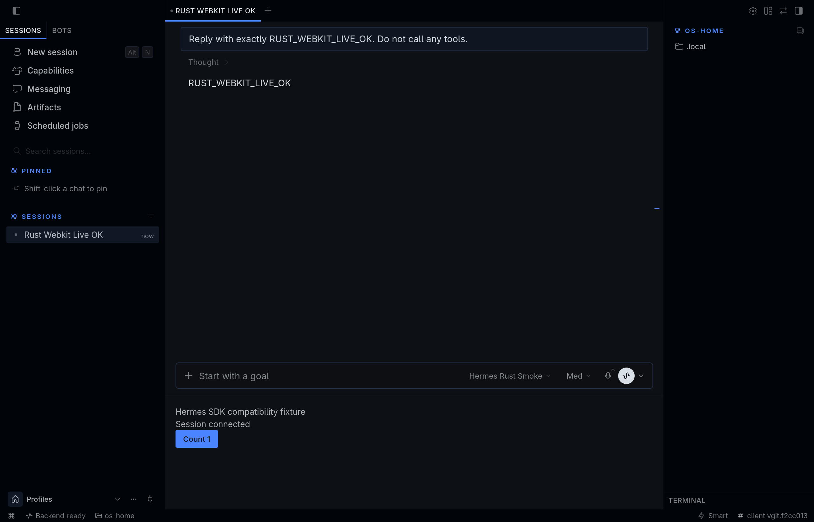

# Hermes Desktop Rust

A Rust/Tauri host for the real [Hermes Desktop](https://github.com/NousResearch/hermes-agent) workspace. Replace Electron's host, not the agent or its extension ecosystem.

**Experimental—not yet a feature-complete replacement for upstream Desktop.** The Linux native window and upstream workspace run; the [compatibility matrix](docs/compatibility.md) lists the native features still missing. This is an independent project, not an official Nous Research release or an approved upstream migration.



The screenshot is from an isolated live run, not a mockup. The extra pane is the SDK compatibility fixture. See [verification and limits](docs/verification.md).

## Approach

- **Rust for native responsibilities:** window lifecycle, bounded CLI launch, menus, navigation and connection recovery.
- **The existing Hermes UI:** React/TypeScript inside the platform webview—WebKitGTK on Linux, WKWebView on macOS, WebView2 on Windows.
- **The existing Hermes backend:** sessions, tools, approvals, providers, memory, skills, MCP and agent plugins remain upstream responsibilities. No parallel agent implementation or new plugin SDK.
- **Small, separable UX fixes:** keyboard-operable pane tabs, grapheme-safe CJK tooltip wrapping, and reliable session-export blob lifetime, delivered as tested upstream patches.

See [architecture](docs/architecture.md), [community reports](docs/community-feedback.md), [constructive X feedback](docs/community-x.md), and [accessibility evidence](docs/a11y-verification.md). A smaller runtime is not proof of a faster transcript renderer; no unmeasured performance claims are made.

## Build and run

Requirements: current stable Rust, Git, Node.js 26, and a compatible installed Hermes CLI. Native prerequisites follow [Tauri's platform guide](https://v2.tauri.app/start/prerequisites/): Linux needs GTK3 and WebKitGTK 4.1 development libraries; Windows needs the MSVC toolchain and WebView2; macOS needs Xcode command-line tools.

Linux recording also needs GStreamer encoders. On Ubuntu 24.04, include `gstreamer1.0-plugins-good` and `gstreamer1.0-plugins-bad`; WebKit alone is not sufficient. The native test verifies real recording rather than treating permission as proof that a codec is available.

```sh
git clone --recurse-submodules --branch feat/rust-desktop https://github.com/willbohn/hermes-desktop-rust.git
cd hermes-desktop-rust
node scripts/build-renderer.mjs
cargo run --locked -- --renderer .build/webapp-dist
```

The renderer script builds the pinned upstream source plus this repository's patches in a disposable checkout. It reuses upstream's locked dependency preparation and atomic build publication, without editing the submodule or downloading an Electron runtime.

The initial implementation is on `feat/rust-desktop` for review; the clone command selects that branch explicitly.

Hermes Webapp must be enabled in the profile you want to use:

```sh
hermes config set webapp.enabled true
```

If that profile's gateway was already running with Webapp disabled, the setting takes effect at its next restart. Use Hermes's normal lifecycle controls **when it is safe to interrupt that gateway**. This host does not change that setting or implement a second gateway lifecycle. The installed CLI owns startup; its ensure policy can replace an incompatible owner belonging to the same install. Do not point an experimental CLI at a live home.

Other entrypoints:

```sh
# Choose an installed profile explicitly.
cargo run --locked -- --profile work --renderer .build/webapp-dist

# Connect to an already configured HTTPS Webapp; authenticate in its page.
cargo run --locked -- --url https://your-hermes.example/

# Inspect options, including a custom Hermes executable/home.
cargo run --locked -- --help

# Build the native binary with release optimizations.
cargo build --locked --release
```

Keep launch-ticket URLs out of arguments, logs and screenshots. Local launch obtains a fresh ticket privately from the CLI; the launcher UI never receives it. Closing this app does not stop the canonical gateway. Remote files and terminals belong to the **gateway host**, not necessarily your laptop.

## Develop and test

Linux's native behavior test also needs **Xvfb, xdotool, D-Bus with `gdbus`, and openbox** (an existing kwin_x11 works too). It runs on a separate display with a private bus and disposable home; it does not drive your desktop. See [download/window evidence](docs/download-verification.md).

```sh
cargo fmt --all -- --check
cargo test --locked
cargo clippy --locked --all-targets -- -D warnings
npm test
python3 -m unittest discover -s tests -p 'test_*.py' -v
node scripts/build-renderer.mjs --test
```

`cargo test --locked --no-default-features` exercises launcher/policy code without native GUI libraries. The renderer check runs affected upstream behavior suites before building. CI targets Linux, macOS and Windows; compilation is not a substitute for native UI, accessibility or authenticated-provider testing on those platforms.

`scripts/run-isolated-native.py` is a developer-only Linux/WebKit smoke helper. It isolates OS home, app data and Hermes host-owner locks, strips provider credentials, and opens a loopback-only inspector for `scripts/webkit-inspector.mjs`. Do not use it against a live profile. `tests/fixtures/rust-host-smoke/plugin.js` exercises the unmodified public SDK; it is not a replacement for production plugins or an inference mock.

## Security and contribution

Downloads require **Workspace → Choose download folder…** (Ctrl/Cmd+Shift+D). This permits downloads from all workspaces into that folder for this app session; use **Stop allowing new downloads** to revoke new transfers. If the first attempt was blocked, choose a folder and retry the export. Authentication and blob data stay in the original webview, not an external browser.

That revoke action also resets a stuck consent prompt; old dialogs cannot restore permission afterward. **Connect or recover…** (Ctrl/Cmd+Shift+O) remains available after closing the connection launcher while a workspace is open. Ctrl/Cmd+W closes the focused window; Ctrl/Cmd+Q explicitly quits the host, not the shared gateway.

Linux completion notifications use **Workspace → Allow notifications in this window…** (Ctrl+Alt+N). Consent covers that window's content, including embedded pages, for this app session. **Stop new notifications** (Ctrl+Alt+M) revokes host delivery across workspaces without rewriting the browser's permission state. A browser-level refusal requires quitting and reopening the app before requesting again; sign-in data is not cleared. Persistent/service-worker OS notifications are deliberately suppressed because WebKit cannot attribute them to a consented window. See [notification behavior and limits](docs/notification-verification.md).

Linux microphone requests use a native consent dialog. Access includes embedded content and can continue in the background; **close the workspace to end its access**. Camera and screen capture are not granted by this prompt. The native test exercises consent and real encoding with synthetic devices, not your microphone. Physical audio, provider transcription and other platforms still need verification. See [microphone scope and evidence](docs/media-verification.md).

Only the bundled connection launcher has native IPC permission. Hosted workspace windows do not gain Tauri filesystem or shell access; their existing authenticated gateway and plugin trust model still applies. See [SECURITY.md](SECURITY.md).

Read [CONTRIBUTING.md](CONTRIBUTING.md) before contributing. Upstream fixes should stay small and independently reviewable; a host replacement needs discussion with Hermes maintainers. AI-assisted work and actual verification must be disclosed, without implying human review or upstream endorsement.

MIT licensed. Upstream source and notices are preserved in the pinned submodule; see [NOTICE](NOTICE).
