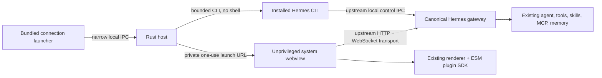
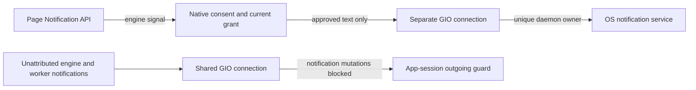

# Architecture decision: retain the workspace, replace the host

Baseline: [`NousResearch/hermes-agent@f2cc013158ce4b89f50154c09486a885835133b9`](https://github.com/NousResearch/hermes-agent/tree/f2cc013158ce4b89f50154c09486a885835133b9), current `main` at the start of this work (2026-10-29). The upstream submodule is pinned; we do not silently follow `main`.

## Choice

Use Tauri 2 and system WebView2/WKWebView/WebKitGTK to host the upstream **Webapp Desktop renderer**, not the old dashboard or a terminal in a web page. Hermes already implements the browser Desktop adapter in `apps/desktop/src/lib/browser-desktop-bridge.ts`. Its RPC client, session authority, plugin loader and React UI stay upstream.

The Rust host owns the connection launcher, bounded CLI-client lifecycle, window chrome and navigation policy. It does not reimplement model selection, tools, approval rules, sessions, memory, terminal RPC, MCP, plugin installation or authentication.

## Why retain a web-based UI rather than rewrite every widget in Rust?

The objective is a better native desktop experience, not a particular percentage of Rust. After explicitly considering an all-native Rust renderer, the chosen boundary remains **Rust host + upstream web UI + existing Hermes agent**.

- Existing desktop plugins export ESM/React components and share the live `@hermes/plugin-sdk` and React bindings (`src/contrib/runtime-loader.ts`). A Rust widget renderer cannot consume that contract directly. Keeping plugin compatibility would require a webview anyway, plus a second UI/state integration to maintain.
- Rich streamed Markdown, code blocks, terminals, artifact HTML and interactive plugin panes already have implementations in the shared renderer. Rebuilding them would create a large regression surface for text input, selection, IME, accessibility, streaming and layout.
- System webviews remove the need for this host to ship Electron's own Chromium/Node runtime. They do **not** remove JavaScript layout/painting costs; Windows WebView2 is itself Chromium-based. Performance improvements still need measurements and targeted fixes.
- Native Rust remains appropriate for window/process lifecycle, bounded connection work and OS integration. Move additional expensive work there only when a measured bottleneck and a concrete consumer justify it; do not add a speculative native-service framework.
- Smaller host changes and separable renderer fixes are easier to review and keep aligned with upstream than a replacement UI toolkit. Upstream acceptance is still a maintainer decision, not guaranteed by the stack.

Revisit individual native widgets or a different rendering backend only if a representative benchmark or an unsolved webview limitation warrants it **and** extension compatibility, accessibility and feature parity can be demonstrated. This decision does not waive the native-parity gaps below.

**Trust boundary:** only the bundled launcher window can invoke native commands. Remote pages and same-origin workspace popouts get no Tauri capabilities. One-use launch tickets stay out of logs, native window titles and persisted settings. External websites cannot cause an OS-browser launch without native confirmation. Plugins still have upstream application authority: this does **not** turn trusted ESM plugins into a sandbox.

## Why not port every Electron IPC handler now?

The upstream Electron host spans filesystem, SSH, cloud authentication partitions, installers, overlays, preview browser guests and OS integrations. Porting the whole bridge before a usable result creates a second large host implementation to keep in sync. Keeping an Electron subprocess to fake parity would defeat the purpose of this project.

The Webapp bridge is an existing upstream compatibility seam, not an invented universal adapter. It gets a native workspace running without forking the agent or plugin SDK. Small renderer fixes are separately reviewable patches, applied only to a disposable build workspace; the pinned submodule stays pristine.

## Consequences

This is an **experimental alternative host**, not yet a feature-complete replacement for Electron Desktop. The browser bridge intentionally refuses native-only operations. In particular, Electron's isolated embedded Chromium browser and its guest preload cannot be translated faithfully to a plain system webview. See [compatibility.md](compatibility.md).

Local launch attaches through `hermes webapp --no-open --skip-build`. The CLI owns gateway startup and authentication. Closing this app does not terminate the canonical gateway. Builds require an explicit user action; the host never silently enables Webapp, changes provider assignments, installs an agent or copies credentials.

A shell swap is not evidence of faster React rendering. Existing transcript scheduling/virtualization stays intact; renderer issues need renderer fixes and measurements. No automatic update feed, cloud service, telemetry or parallel extension framework is added.

## Linux notification boundary

The guard is installed before webviews; shared-bus loss fails closed. Every page still receives its native permission/delivery handlers, with explicit denial on the launcher. No workspace IPC or browser-permission polyfill is added. This is an engine-integration boundary, not a sandbox against other processes under the same OS user. [Native evidence and limitations](notification-verification.md) describe the dependency on WebKit's shared GIO backend.

## Upstream route

Discuss a native-host migration with maintainers before proposing it as a replacement. Small accessibility fixes can be reviewed independently. This standalone repository preserves upstream attribution and avoids assuming that an independent product belongs in the core tree. No endorsement or likelihood-of-acceptance claim is made.
